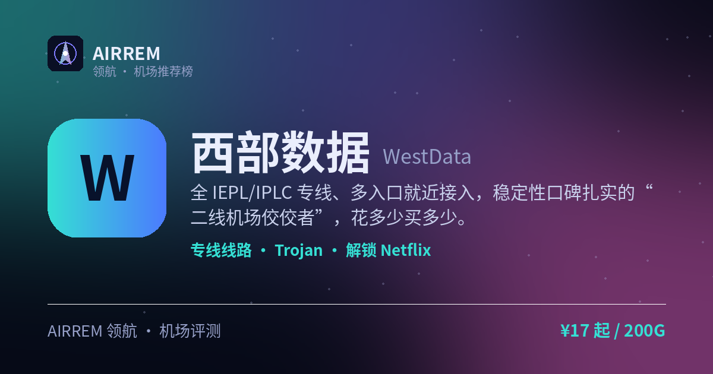

<p align="center"></p>

# 西部数据机场怎么样？2026 实测：稳定专线党

> **西部数据** 适合谁？要低延迟专线、常年稳定不掉线。全 IEPL/IPLC 专线、多入口就近接入，稳定性口碑扎实的“二线机场佼佼者”，花多少买多少。

<p align="center">
<a href="https://t.rtxk.us/t/x2m8qpb"></a>
<a href="https://air-rem.github.io/westdata/"></a>
</p>

👉 **[西部数据 官网注册入口](https://t.rtxk.us/t/x2m8qpb)** ｜ 优惠码：`WD-DDR6` ｜ [完整评测与横向对比](https://air-rem.github.io/westdata/)

---

## 我们的结论

老牌全专线里性价比很高的一家：线路稳、延迟低、按量灵活，把“稳定”放第一位的用户闭眼入门不亏。缺点是双向计流量、偶尔遭攻击，建议先月付试水。


## 基本信息

| 项目 | 内容 |
| --- | --- |
| 机场名称 | 西部数据（西数 · WD） |
| 成立时间 | 2021 |
| 线路类型 | IEPL/IPLC 全专线 |
| 支持协议 | Trojan |
| 流媒体解锁 | Netflix / Disney+ / ChatGPT |
| 节点地区 | 香港 · 日本 · 美国 · 德国 等 |
| 计费方式 | 按量计费 ≈ 0.08 元/G |
| 起步价格 | ¥17 / 200G |
| 推荐场景 | 要低延迟专线、常年稳定不掉线 |


## 西部数据 套餐价格

| 套餐 | 价格 | 说明 |
| --- | --- | --- |
| 按量 100G | ≈¥8.8 | 约 0.088 元/G |
| 按量 200G | ≈¥17 | 约 0.085 元/G |
| 按量 500G | ≈¥40 | 约 0.080 元/G |

> 统一“10G/元”价值锚定，按量购买、花多少买多少，常年折扣。具体价格与优惠以官网为准。


## 西部数据是什么

西部数据（WestData，圈内也叫“西数/WD”）是一家 2021 年上线的老牌机场，主打全线 IEPL/IPLC 国际专线。相比动辄跑路的新站，它靠多年稳定运营积累了不错的口碑，被不少测评称为“二线机场里的佼佼者”。

它的定位很清晰：不玩花哨营销，把钱砸在专线带宽和多地入口上，追求“延迟低、晚高峰稳、解锁全”。

## 线路与节点

西部数据是少见的“多入口全专线”机场，在广州、江苏、天津、辽宁等地都设了入口，客户端会就近接入再走专线出海，因此不同地区的用户都能拿到较低延迟。

- 典型线路：广州—香港 IEPL、上海—日本 IEPL、北京—德国 IEPL
- 智能分流：华北/东北就近走京港、京日；江浙沪走沪港；华南走广德
- 官方标称峰值较高，多线程可跑满；单线程约限速 500Mbps

## 协议与客户端

全线采用 Trojan 协议，兼容性极好，几乎所有主流客户端都能直接用，导入订阅即可，新手无需折腾。

- Windows：Clash Verge / v2rayN
- macOS：Clash Verge / Surge
- 安卓：Hiddify / Clash Meta for Android
- iOS：Shadowrocket / Stash

## 解锁能力

多数节点可稳定解锁 Netflix 等主流流媒体，并支持 ChatGPT。专线线路在看 4K、拖进度条时的缓冲控制较好，适合既要科研又要追剧的用户。


## 优点与缺点

**✅ 优点**

- 全 IEPL/IPLC 专线，延迟低、晚高峰稳
- 2021 年老牌，长期运营口碑扎实
- 多地入口就近接入，全国体验均衡
- 按量计费灵活，不浪费流量
- Trojan 兼容性好，导入即用

**⚠️ 缺点**

- 双向计流量：上传也会扣量
- 单线程约限速 500Mbps
- 偶尔遭到攻击，高峰期可能波动——建议先月付


## 适合谁 / 不适合谁

| 👍 适合 | 👎 不适合 |
| --- | --- |
| 追求专线稳定、延迟敏感的用户 | 想要“不限量”敞开用的用户 |
| 按量控费、用多少买多少 | 完全不想关心流量计量的极简党 |
| 既要科研又常看流媒体 |  |


## 常见问题

**Q：为什么建议先买月付 / 小额档？**

A：西部数据偶尔会遭到攻击，机场主靠加高防硬扛，个别时段可能波动。先用月付或小流量档验证稳定性，稳了再续更放心。

**Q：流量是怎么计算的？**

A：它是双向计费——上传流量也会计入。如果你有大量上传（如同步网盘、发视频），实际消耗会比预期高，建议留出余量。


## 同类机场推荐

拿不定主意？可以再看看这几家同类型的：

- **[糖果云](https://air-rem.github.io/candycloud/)** — 影视追剧旗舰，¥18 起
- **[红杏云](https://air-rem.github.io/hongxing/)** — 流媒体 / 大流量性价比，¥20 起
- **[渔云](https://air-rem.github.io/yuyun/)** — 长期稳定 / Emby 影音，¥9 起

全部 38 家机场的横向对比与选购方法论：**[AIRREM 领航 · 机场大全](https://air-rem.github.io/airports/)**


西部数据 再好，也只是让你**连得上**。连上之后要用 Claude / GPT / Gemini，可以看看下面这个：

<p align="center">
<a href="https://i.rtxk.us/i/r37kbkg"></a>
<a href="https://i.rtxk.us/i/r37kbkg"></a>
<a href="https://guide.rtxk.us/tutorial/ai-coding/leonis-ai-cc-switch-guide.html"></a>
</p>

> ### 🦁 Leonis AI 中转站 —— 一个端点，抵达所有模型
>
> 机场解决「**连得上**」，[Leonis AI](https://i.rtxk.us/i/r37kbkg) 解决「**用得顺**」。把 **Claude、GPT、Gemini、Grok、Antigravity 等 6+ 模型** 统一成同一个 API 端点：**不改代码、不换客户端，只替换一行 Base URL**。
>
> - **原生工具直连**：Claude Code、Codex CLI、Cherry Studio、NextChat、OpenAI SDK 官方客户端直接用，不需要额外插件或魔改。
> - **全程流式不缓冲**：长回答边生成边吐字，不会卡到最后一次性蹦出来。
> - **多账号池调度**：后端多号轮询，单号被限流时自动顶上，稳定性更好。
> - **一个密钥全模型**：Claude、GPT、Gemini 共用一把 `sk-` 密钥，省心。
>
> ```bash
> export ANTHROPIC_BASE_URL=https://你的专属端点
> export ANTHROPIC_AUTH_TOKEN=sk-你的密钥
> claude
> ```
>
> OpenAI 兼容客户端填 `https://你的专属端点/v1`；也支持 cc-switch「导入到 CCS」一键导入。
> 邮箱注册几十秒，**注册即送体验额度** → **[免费注册 Leonis AI](https://i.rtxk.us/i/r37kbkg)** ｜ [cc-switch 接入教程](https://guide.rtxk.us/tutorial/ai-coding/leonis-ai-cc-switch-guide.html)

---

<sub>数据更新：2026-07 ｜ 价格、套餐与优惠码以官网实时为准 ｜ 本仓库为第三方评测整理，与 西部数据 官方无隶属关系 ｜ 请遵守当地法律法规使用网络服务。</sub>

<sub>关键词：西部数据、WestData、西数机场、IEPL专线、IPLC、Trojan机场、机场推荐、机场评测、Netflix解锁</sub>
